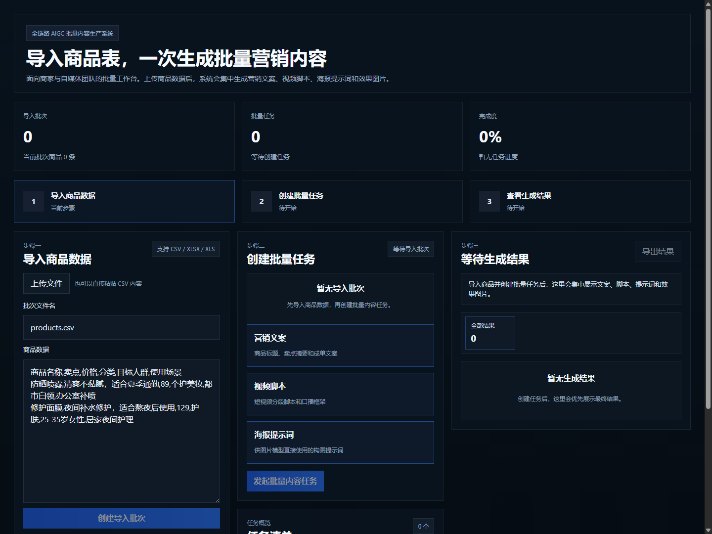

# AI 内容协作平台（数字 IP / 跨境商业内容）

默认工作区面向数字 IP 和游戏内容团队，支持世界观设定下多章节批量创作：
LangGraph 四节点（调研、撰写、润色、审核）、工具调用、批次轮询、章节恢复。
技术实现、Redis Stack 配置及能力边界见 [编排器说明](apps/ai-orchestrator/README.md)。

原有跨境商业内容工作区仍保留，支持商品素材的批量生成和导出。

## 垂类定位与能力冻结（2026-12，阶段 0 已执行）

本项目属于**电商垂类产品线**，角色是**素材供给**（Listing 文案 / 图片 / 视频）。整合方案见
[电商垂类整合计划](../电商垂类整合计划/README.md)。

以下能力已冻结：后续迭代不再投入、不对外演示、验收不计入。**冻结不等于删除**，代码与测试全部保留，恢复条件见冻结清单。

| 冻结项 | 代码落点 | 原因 | 恢复条件 |
| --- | --- | --- | --- |
| 数字 IP 工作区作为默认工作区 | `apps/studio-web/src/App.jsx`（默认 `workspaceMode="ip"`）、`IPWorkspace.jsx`、`apps/ai-orchestrator/app/ip_content/`、`apps/api-server/src/routes/ip-content.js` | 数字 IP / 游戏世界观与电商内容供给无关，且占用默认 tab，电商批量 Listing 生成反而退居第二位 | 明确服务游戏/网文/动漫客户，且商品内容链路已交付 |
| IP 相关测试与本地存储 | `apps/api-server/src/routes/ip-content.test.js`、`localStorage` 键 `ip-content-last-batch` | 随上一项一起冻结；测试保留但不作为对外验收门禁 | 同上 |

**不冻结（电商核心，继续投入）**：`listing-packs` 成品包、`data-hub` 同步与 ingest、商品批量导入/任务/导出、
`ai-orchestrator/app/graphs/nodes/` 单商品内容流水线。

> 已知不一致：`docs/mvp-acceptance-checklist.md` 要求「页面默认进入外贸批量内容工作台」，而当前代码默认是 IP 工作区。
> 切换默认 tab 属于行为变更，按阶段 0 规则不在本次执行范围内，留待后续阶段处理。

冻结清单全文：[阶段0-电商无关能力冻结清单.md](../电商垂类整合计划/阶段0-电商无关能力冻结清单.md)。

## 效果演示

[观看演示视频](demo/demo.mp4)

导入产品数据后，系统可按批次生成：

- 营销文案（标题 / 卖点 / 描述）
- 视频脚本
- 根据文案生成产品图片
- 根据文案生成产品宣传视频

并支持结果预览与 Excel 导出。

## 快速开始（桌面应用）

推荐用桌面快捷方式启动，不需要命令行：

1. 首次安装快捷方式（管理员不必要，当前用户即可）

   ```bash
   npm run app:install
   ```

   会在桌面生成一个图标，并在开始菜单生成一个入口：`内容创作平台`。

2. 之后每次直接双击桌面图标即可。启动约 10 到 20 秒，期间无控制台窗口闪烁：

   - 三个服务在后台拉起，就绪后弹出独立应用窗口，同时任务栏托盘出现应用图标
   - **关闭窗口即退出**：窗口关掉的瞬间，服务停止、托盘图标消失，不留后台进程
   - 再次双击图标不会重复启动，只会把已有窗口调到前台

其他命令：

| 命令 | 作用 |
| --- | --- |
| `npm run app:install:autostart` | 额外把快捷方式放进启动目录，开机后自动就绪 |
| `npm run app:uninstall` | 删除桌面与开始菜单的快捷方式 |
| `npm run app:launch` | 在当前终端里启动（等同双击图标） |
| `npm run app:stop` | 停止服务并关闭应用窗口（命令行排障用） |

实现说明：

- `app-shell.vbs` 用 `wscript` 以隐藏方式调用 PowerShell，避免双击时闪黑窗。
- `scripts/launch-app.ps1` 复用 `dev.ps1 content` 拉起服务，轮询 `state.json` 里的 studio 地址，
  就绪后用 Chrome 或 Edge 的 `--app` 模式打开独立窗口（独立 `user-data-dir`，不影响日常浏览器），
  随后以托盘图标驻留，每 2 秒检测一次该窗口的进程是否还在。
- 关闭窗口即视为退出：启动器关闭窗口进程、停止三个服务、清理 `.local-stack` 状态文件后自行结束。
- 实例检测基于 `app-shell.pid` 里的 **pid 与进程启动时间**（防 pid 复用误判）；
  第二个实例只聚焦已有窗口，不会起第二套服务，也不会覆盖第一个实例的记录。
- 启动失败会弹出提示框并指向 `.local-stack/desktop-launch.log`，不会静默失败。
- 应用图标是生成物：`python scripts/make-app-icon.py` 用 Pillow 绘制多尺寸 ICO，
  同时写 `public/favicon.ico`（浏览器标签）与 `public/app-icon.ico`（快捷方式）。
  两者分文件是有意的——Windows 按路径缓存快捷方式图标，沿用旧文件名会继续显示旧图。

## 演示

- Web 工作台：`http://127.0.0.1:5201`（端口冲突时自动顺延，实际地址见 `.local-stack/state.json`）
- API 服务：`http://127.0.0.1:3100`
- AI 编排器：`http://127.0.0.1:8110`

演示视频和封面：



- 演示视频文件：[`demo/demo.mp4`](demo/demo.mp4)

## 项目能力

当前版本已打通：

- 批量导入产品数据
  - 支持 `CSV / XLSX / XLS`
  - 自动识别常见外贸字段（名称、卖点、FOB/MOQ、品类、市场、场景）
- 批量创建内容任务
  - 按勾选的内容类型生成，不再强制跑全链路
- 结果工作台
  - 中文界面
  - 任务进度自动刷新
  - 图片预览
  - 结果导出 Excel
- 持久化存储
  - PostgreSQL 已接通；未配置时回退内存模式
- AI 提供方接入
  - Agnes 文本/图片链路
  - 魔塔社区链路补位
  - OpenAI 视频链路保留实验入口

## 当前真实边界

这是可运行的 MVP，不是完整商业平台。当前仍未完成：

- **全局管理员与跨项目角色**（项目级权限矩阵已具备，见下节；平台级 admin 未做）
- SSO
- 多渠道自动发布
- Text2SQL 商品数据库联动
- 稳定生产级视频生成链路
- 多渠道自动优化
- 生产级部署与观测（指标/分布式追踪、S3 后端真实环境验收、账单对账）

多智能体协作层（Supervisor + 调研/撰写/润色/审核 角色 Agent、共享记忆、跨 agent
消息、审核失败自主改写闭环）已在 `apps/ai-orchestrator/app/agents/` 实现，默认开启。

## 用户身份（AUTH_MODE）

此前 API 层把所有请求都当成同一个演示用户（仓储里写死 `user_demo`），项目、额度、
作品无法按用户隔离。现在补了身份层，但**默认关闭**以保持既有使用方式不变：

| AUTH_MODE | 行为 | 适用 |
| --- | --- | --- |
| `off`（默认） | 所有请求解析为 `user_demo`，行为与改造前一致；`/api/auth/*` 返回 404 | 双击启动、本地演示、既有脚本 |
| `local` | 接受 `Authorization: Bearer <token>`；无 token 降级为匿名（可读不可写） | 局域网多人共用、内测 |
| `strict` | 必须带有效 token，否则 401 | 对外暴露 |

启用方式（至少两个变量一起给）：

```powershell
$env:AUTH_MODE="local"
$env:AUTH_SECRET="至少16位的随机字符串"   # 不配置则登录接口 fail-closed 拒发 token
```

接口：

- `POST /api/auth/register` `{username, password, email?}` — 用户名≥3、密码≥8
- `POST /api/auth/login` `{username, password}` — 返回 `token` 与 `user`
- `GET  /api/auth/me` — 带 token 返回当前身份

设计取舍：

- **默认 `off` 而不是强制鉴权**：本项目的启动方式包括双击桌面图标与 `一键启动.bat`，
  用户不会先登录。默认强制鉴权会让现有使用方式直接坏掉，因此把升级做成显式开关。
- **不引入 jsonwebtoken**：token 用 `node:crypto` 的 HMAC-SHA256 自签（见
  `src/lib/local-auth.js`），十几行够用，符合项目既有的零依赖倾向。
- **密码用 scrypt + 每用户独立 salt**，比较用 `timingSafeEqual`。
- **登录失败不区分"用户不存在"与"密码错误"**，避免用户名枚举。
- **`operator_type='system'` 的审计记录，`operator_id` 也记 `system`**：此前写死
  `user_demo`，会把系统状态流转误记成用户操作，审计时无法区分谁触发的。

未做（明确留白）：refresh token / 会话吊销、SSO、平台级全局管理员。这些都需要
持久化会话与并发控制，不宜在补身份这一步顺手加。

内存模式注意：未配 `DATABASE_URL` 时用户存在进程内存里，**重启即丢失**。
真实多用户必须配 PostgreSQL（用户表 schema 见 `infra/sql/001_init_core_schema.sql`，
密码存新增的 `content_platform.user_credentials`，不改动既有 users 表）。

## 项目级权限

身份层解决"请求是谁"，这一层解决"他能做什么"。数据单元是 `project`——商品、内容
任务、作品、额度都挂在项目下，因此角色是**项目级**而非全局：一个人可以是 A 项目的
美术、B 项目的只读。

角色（存 `project_members.role_code`，schema 里本来就有的字段）：

| 角色 | 权限 |
| --- | --- |
| `owner` | 全部，含成员管理与发布 |
| `editor` | 读写项目内容与素材；**不能**管成员、删项目、发布 |
| `viewer` | 只读 |

要点：

- 路由检查的是**权限点**（`project:write`、`member:write`…）而不是角色名，
  将来加角色只改矩阵表，不用在路由里加 `if`。
- 发布（`content:publish`）只给 owner：它是对外动作，误操作代价比普通写操作高一个量级。
- **未知角色一律拒绝**而不是放行——`role_code` 来自外部输入，放行等于把拼写错误
  变成提权漏洞。
- 两条防线：**不能降级/移除最后一位 owner**（否则项目失去管理者，只能改库救）、
  **不能降级或移除自己**（自杀式操作且无补偿路径）。换 owner 请先提升他人再降自己。
- 非成员访问返回 **404 而不是 403**：403 等于告诉对方"这个项目存在但你没权限"，
  可用于枚举项目 id。

接口：

- `GET    /api/projects/roles` — 角色与权限点清单（前后端共用同一份枚举）
- `GET    /api/projects/:projectId/members`
- `PUT    /api/projects/:projectId/members/:userId` `{roleCode}`
- `DELETE /api/projects/:projectId/members/:userId`

`AUTH_MODE=off` 时权限检查放行并标记 `bypass`——本地单用户演示里"权限"没有意义，
强加检查只会破坏既有使用方式。

### 平台级资源：为什么有第二类权限点

`import_batches` / `content_jobs` / `products` 这几张表**没有 `project_id`**
（见 `infra/sql/005_import_batch_domain.sql`），只按 `batch_id` 关联，是平台级共享资源。

本可以给它们加 `project_id` 后套项目级校验，但那是独立的数据迁移工作（加列 + 回填 +
改所有读写路径）。在权限这一轮里硬塞，只能靠"猜一个 project id"，那是**假的隔离**——
看起来有隔离，实际拦不住任何东西，比诚实标注为平台级更危险。

因此用独立权限点：

| 权限点 | 含义 | owner | editor | viewer |
| --- | --- | --- | --- | --- |
| `platform:import` | 导入商品批次 | ✓ | ✓ | — |
| `platform:generate` | 创建内容任务 / 工作流 | ✓ | ✓ | — |
| `platform:ai_chat` | AI 对话 | ✓ | ✓ | — |
| `content:publish` | 发布 / 推送商城 / data-hub sync | ✓ | — | — |

已挂上守卫的路由：

| 路由 | 权限点 | 类型 |
| --- | --- | --- |
| `POST /api/content-jobs` | `platform:generate` | 平台级 |
| `POST /api/content-workflows` | `platform:generate` | 平台级 |
| `POST /api/import-batches` | `platform:import` | 平台级 |
| `POST /api/chat` | `platform:ai_chat` | 平台级 |
| `POST /api/data-hub/jobs/:id/ingest` | `platform:generate` | 平台级 |
| `POST /api/data-hub/jobs/:id/sync` | `content:publish` | 平台级（会对外上架） |
| `POST /api/listing-packs/:id/push` | `content:publish` | 平台级 |
| `POST /api/creation-requests` | `content:write` | **项目级**（body 带 projectId） |
| `POST/PUT/DELETE /api/projects/:id/members` | `member:write` | **项目级** |

`GET /api/data-hub/search` 是只读检索，刻意不挂写权限。

**平台级角色从哪来**：服务端查 `project_members`，取该用户在所有项目中的最高角色
（详见下一节）。不属于任何项目的已登录用户平台级角色为 null，按 `viewer` 处理——
只能读，不能做平台级写操作。

将来若要把批次/任务真正纳入项目隔离，需要给表加 `project_id` 并回填，
那是独立的一轮工作，不该和权限改动混在一起。

> **2026-12 更新：导入批次已完成项目归属（方案 A，单一归属）。**
> 详见下一节。

## 导入批次的项目归属

**为什么单独做这一轮**：权限点管的是"能不能写"，但管不了"能看谁的"。
原先 `listImportBatches()` 直接 `select` 全表，任何登录用户都能看到别人导入的
商品批次——含成本价、FOB、MOQ 这些敏感字段。这不是加一个权限点能解决的。

**改动**：

| 层 | 内容 |
| --- | --- |
| schema | `009_import_batch_project_scope.sql`：`import_batches` 加 `project_id`（可空）+ 索引 |
| 仓储 | `createImportBatch` 记录归属；`listImportBatches({ projectIds })` 按项目过滤 |
| 路由 | 列表按"当前用户是成员的项目"过滤；导入时显式指定 projectId 则校验成员身份 |

**三条明确的约定**：

1. **`project_id` 可空 = 未分配。** 历史批次没有归属，填 NULL 而不是伪造一个 id。
2. **不设外键级联删除。** 删项目不该连带删掉商品批次（可能是从供应商导进来的唯一
   副本）。项目被删时批次变成"未分配"，由人工处理——静默丢失比留脏数据危险。
3. **单一归属。** 一个批次属于一个项目。若将来需要跨项目复用，再加关联表，
   从单列迁到多对多是增量改动，不是推倒重来。

**两个刻意的宽松，都有理由**：

- **未分配批次对已登录用户可见。** 否则用户会"导入完就消失"（前端还没有项目选择器）。
  响应里带 `includedUnscoped: true` 让前端可以提示"未分配，建议归入项目"。
  等前端接上选择器后，这个口子应该关掉。
- **`platform:import` 允许无项目归属的账号使用**（`allowUnscoped`）。
  导入是"把自己的数据带进来"，风险局限在调用者自己；而生成、对话、发布会产生
  真金白银的 API 费用或对外可见的内容，不享受这个豁免。这是产品判断，不是技术妥协。

**校验顺序很重要**：项目归属校验（非成员 → 404）必须排在平台级守卫（无角色 → 403）
之前。反过来的话，指定了别人 projectId 的请求会先拿到 403，既误导又泄漏
"你可能不是成员"这层信息。

## 额度计费

**背景**：`credit_accounts` / `credit_transactions` 在 `004_credit_domain.sql` 里
就建好了，甚至种了 `user_demo` 1000 点，但**全项目没有一处读它或扣它**。等于谁
登录都能无限次调模型——生成文案、图片、视频全是真金白银。

规则：**调付费 API 时预扣额度，不足直接阻断（402）。**

### 计费动作与单价

单价通过环境变量配置，**默认值只是占位，上线前必须按模型实际单价换算**：

| 环境变量 | 动作 | 默认值 |
| --- | --- | --- |
| `CREDIT_COST_CHAT` | 对话生成 / 改文案（文本模型） | 1 |
| `CREDIT_COST_CONTENT_WORKFLOW` | 内容工作流（图片/视频，最贵） | 10 |
| `CREDIT_COST_CREATION_REQUEST` | 创作请求（转编排服务） | 10 |
| `CREDIT_INITIAL_GRANT` | 新用户初始赠额 | 100 |

非法值（负数、非数字）一律回落默认——计费参数写错不该让服务起不来。

### 已挂计费的路由

| 路由 | 动作 |
| --- | --- |
| `POST /api/chat` | `chat` |
| `POST /api/content-workflows` | `content_workflow` |
| `POST /api/creation-requests` | `creation_request` |

`GET /api/auth/me/credits` 查余额与单价，前端可在付费前显示"本次约消耗 N 点"，
或 402 后引导充值。

### 三个关键设计决定

**1. 预扣 + 失败回补（不是成功后扣）。**
成功后扣意味着"查余额"与"扣减"之间有窗口，并发请求可以双花——余额 10 点、单价
10 点，两个并发请求都能通过检查。预扣把窗口收在一条原子 UPDATE 里：

```sql
update credit_accounts
   set available_credits = available_credits - $cost
 where owner_id = $uid and available_credits >= $cost
```

影响行数为 0 就是余额不足，不需要额外查询判断。下游失败则回补，记一条独立的
`refund` 流水，账目可对。

**2. 用 402 而不是 403。**
语义不同：403 是"你角色不够"（换人来做就行），402 是"你没钱了"（充值就行）。
前端据此显示"余额不足，去充值"而不是"无权限"，处置路径完全不同。

**3. 校验在计费之前，服务可用性检查在计费之后。**
- 参数无效（空 messages、缺 prompt）→ 400 且**不扣费**，不能为无效请求收钱。
- 服务未配置（503）→ 排在计费**之后**并显式回补。理由：余额不足是用户必须先
  知道的事，否则他修好编排配置后仍会因余额失败，白折腾一轮。

### 幂等

支持 `Idempotency-Key` 请求头。同一 key 重复提交只扣一次——流水表的
`unique(biz_type, biz_no)` 就是为此设计的。没有 key 时每次调用视为新的一笔
（符合"每次调用都计费"）。

### AUTH_MODE=off 不扣费

本地演示没有真实身份，扣谁的额度都没意义。与权限层的 bypass 保持一致，
否则双击启动立刻不可用。

### 内存模式的限制

未配 `DATABASE_URL` 时额度存在内存里，**重启即回到初始赠额**。真实计费必须配
PostgreSQL——这也是 `PostgresCreditRepository` 存在的原因（原子条件更新 +
事务内幂等闸门）。

### 前端已接入的门

后端守卫全部就位后，前端把**实际渲染的写操作**都接上了 `PermissionGate`：

| 前端动作 | 对应接口 | 权限点 | 无权限时 |
| --- | --- | --- | --- |
| 生成 / 修改宣传文案 | `POST /api/chat` | `platform:ai_chat` | 显示原因，不显示按钮 |
| 根据文案生成图片/视频 | `POST /api/content-workflows` | `platform:generate` | 显示原因，不显示按钮 |
| 推送到商城 | `POST /api/listing-packs/:id/push` | `content:publish` | 显示原因，不显示按钮 |

前端请求统一经 `authHeaders()` 带上 `Authorization`。

**角色不再由前端声明（2026-12 改）**：早期实现读请求头 `X-Content-Role`，那是前端
自述。现在后端守卫改为查 `project_members` 表、取该用户在所有项目中的**最高角色**
作为平台级角色，前端无法声明。已验证：伪造 `X-Content-Role: owner` 不会提权。

新增 `GET /api/auth/me/projects` 供前端查询自己各项目的角色与折算出的平台级角色：

```json
{
  "userId": "user_xxx",
  "memberships": [{ "projectId": "project_a", "roleCode": "editor", "status": "active" }],
  "platformRole": "editor",
  "actions": ["project:read", "content:write", "platform:generate", "..."]
}
```

前端用它控制按钮显隐；真正的判定仍在后端。本地缓存的 roleCode 只作首屏占位，
拿到服务端结果后立即覆盖——否则用户可能因缓存里是 owner 而短暂看到不该看的按钮。

**为什么平台级角色取"最高"而不是要求专门的平台管理员**：项目角色是项目级概念，
平台级动作需要折算规则。取最高是唯一不引入新概念（不必新增"平台管理员"表与
生命周期管理）的做法。代价是任一项目的 owner 都能做平台级写操作——在当前
"批次/任务是全局共享资源"的事实下，这与数据模型一致。

## 前端权限显示

后端能正确拒绝越权，但前端如果还把所有按钮给所有人看，用户点了才吃 403 ——体验差，
而且会让人误以为权限没生效。因此前端也接入了一层：

| 文件 | 职责 |
| --- | --- |
| `src/permissions.js` | 与后端同一套权限点矩阵 |
| `src/session.js` | token 存取、登录/注册、探测后端 `authMode` |
| `src/PermissionGate.jsx` | `<PermissionGate>` 组件、`<AuthPanel>` 登录面板、`usePermissionSession` hook |

**前端矩阵只用于隐藏按钮，不是安全边界。** 后端才是唯一权威。两份矩阵不一致时，
最坏结果是多显示或少显示一个按钮，不会造成越权。为了让不一致尽快暴露，
`permissions.test.js` 用与后端相同的边界用例（editor 不能管成员、viewer 不能写等）。

行为：

- 后端 `authMode=off` → 前端不显示登录界面，所有权限检查放行，界面与改造前一致。
- `local`/`strict` → 顶栏出现「登录」，登录后按项目角色显示可执行操作；
  无权限时**显示原因**（如"只有项目 owner 可以发布"），而不是给一个不说话的灰按钮。
- `api-server` 的 `/api/health` 新增 `authMode` 字段，前端靠它判断要不要显示登录
  界面。不让前端自己读环境变量：构建产物与后端配置可能不同步，问后端才准。

两个实现取舍：

- **token 存 localStorage**（而非 sessionStorage）：这是明确的安全妥协。理想是
  HttpOnly Cookie + CSRF 防护，但需要后端同时改造会话与跨域配置。代价是 XSS 可读
  token，收益是刷新不用重登。用较短的 token 有效期（12 小时）限缩窗口。
- **401 与 403 分开处理**：401 清 token 提示重登；403 绝不进 token 清理分支——
  否则用户会莫名其妙被登出，再登一次结果一样，问题定位会跑偏。
- **`/api/health` 探测失败一律回落 `off`**：网络抖动不该让用户突然看到"要求登录"。

四项生产级增强层也已在 `apps/ai-orchestrator/app/` 落地：
- `evaluation/`：确定性多维评测 + 提示词自优化闭环（`PROMPT_OPT_ENABLED=1` 开启自优化）
- `safety/`：内容安全双层审核（规则层始终开启，LLM 层 `SAFETY_LLM_ENABLED=1` 开启）
- `cost/`：按模型单价核算单章节与批次成本（`cost` / `costSummary`）
- `storage/` + `queue/`：对象存储抽象（本地磁盘 / S3 兼容）与任务队列抽象
  （`MemoryJobQueue` / `RedisJobQueue`），`worker_loop` 可在两种后端持久领取任务

## 系统架构

```text
apps/
  studio-web/         React + Vite 工作台（多 Agent 内容生成前端）
  api-server/         Node + Express API 服务
  ai-orchestrator/    FastAPI + LangGraph 编排服务（多智能体协作层 + 四项增强层）
  data-hub/           商品知识数据服务
  commerce-api/       暂存的独立站实验代码，不参与主链路
  seller-admin/       暂存的独立站实验代码，不参与主链路
  storefront/         暂存的独立站实验代码，不参与主链路

data/                 JSON 兜底数据（未配 PostgreSQL 时使用）
db/                   早期 Postgres 初始化脚本
infra/sql/            PostgreSQL 结构化表（001~008 迁移）
scripts/              本地栈启停、数据库初始化、校验与演示脚本
src/                  早期文件存储适配层（scripts/init-postgres.js 依赖）
storage/generated/    本地生成产物
storage/assets/       生成资源
demo/                 演示素材与 UI 截图
docs/                 架构、部署运行手册、验收清单
```

职责分工：

- `studio-web`：产品导入、批量任务、结果浏览和导出；同时承载「数字 IP 创作」与
  「内容工作流」两个工作区
- `api-server`：批次 / 产品 / 任务 / 结果 / 导出、PostgreSQL、统一 API
- `ai-orchestrator`：单产品内容流水线、按 contentTypes 条件生成、回调落库

### 前端设计系统

`apps/studio-web/src/styles.css` 使用一套令牌化设计系统（品牌色阶、语义色、圆角、
阴影、焦点环），组件样式按「壳层 / 控件 / 面板 / 列表 / 状态 / 工作流 / IP 工作台 /
深色模式 / 入场编排 / 插画」分节组织。改动样式时优先复用已有令牌，不要写死颜色值。

补充约定：

- **深浅主题**：令牌在 `:root` 定义，深色模式通过 `[data-theme="dark"]` 覆盖整套令牌。
  组件样式只引用令牌，不要写 `#fff` 这类绝对值（品牌渐变上的白字除外）。
  主题偏好由 `src/theme.js` 管理，显式选择优先、其次跟随系统，`main.jsx` 在渲染前落主题避免闪白。
- **字体**：`apps/studio-web/public/fonts/inter-latin.woff2` 是本地 Inter 子集，带 `unicode-range`
  限定，只作用于拉丁字形，中文回落系统字体；运行时不联网拉取，许可见同目录 `OFL.txt`。
- **插画**：`src/Illustrations.jsx` 提供内联线性 SVG，统一 `currentColor` 描边，随主题自动适配。
- **键盘与无障碍**：章节排序支持拖拽与键盘两种方式（聚焦拖拽手柄后按 ↑ ↓），
  交互元素带 `aria-label`；动画在 `prefers-reduced-motion` 下自动关闭。
- 新增动态类名（如 `tone-*`、`workflow-stage-*`、`ip-state-*`）必须同步补样式。

参考截图见 `demo/ui-redesign/`（浅色与深色 × 桌面与移动）。

## 主要技术栈

- 前端：React、Vite
- API：Node.js、Express
- 编排：FastAPI、LangGraph
- 数据库：PostgreSQL
- 文件处理：XLSX / ExcelJS
- 模型接入：Agnes、ModelScope、OpenAI（实验性视频）

## 启动前准备

### 1. 安装依赖

```powershell
cd F:\Python_code\content_create
npm install
```

Python 侧依赖：

```powershell
cd apps/ai-orchestrator
py -m pip install -r requirements.txt
```

### 2. 配置模型密钥

推荐优先使用 Agnes：

```powershell
[Environment]::SetEnvironmentVariable("AGNES_API_KEY", "你的 Agnes API Key", "User")
```

如果不用 Agnes，可配置魔塔：

```powershell
[Environment]::SetEnvironmentVariable("MODELSCOPE_API_TOKEN", "你的魔塔令牌", "User")
```

如需实验视频能力：

```powershell
[Environment]::SetEnvironmentVariable("OPENAI_API_KEY", "你的 OpenAI API Key", "User")
```

可选：内部回调鉴权（本地栈会默认写入 `local-dev-internal-token`）：

```powershell
[Environment]::SetEnvironmentVariable("INTERNAL_CALLBACK_TOKEN", "your-shared-secret", "User")
```

### 3. 配置 PostgreSQL

```powershell
psql -h 127.0.0.1 -U postgres -d postgres -c "CREATE DATABASE ai_content_platform;"
```

```powershell
$env:PGHOST="127.0.0.1"
$env:PGPORT="5432"
$env:PGUSER="postgres"
$env:PGPASSWORD="你的数据库密码"
$env:PGDATABASE="ai_content_platform"
```

初始化结构化表：

```powershell
node scripts/init-core-schema.js
```

## 本地启动

日常开发只需要启动内容平台三服务：

```powershell
.\dev.ps1 content
```

完整业务链路（内容平台 + data-hub + 独立 Flask 商城）：

```powershell
.\dev.ps1 full
```

其他场景：

```powershell
.\dev.ps1 status
.\dev.ps1 stop
.\dev.ps1 hub
.\dev.ps1 shop
```

也可以使用对应的 npm 快捷命令：`npm run local:start`、`npm run local:full`、
`npm run local:status`、`npm run local:stop`。商城仍运行在
`F:\Python_code\Flask项目\flask_shop`，代码、`.env`、MySQL 数据库和内容平台保持独立。

兼容旧入口：

```powershell
npm run stack:start
```

启动后以 `.local-stack/state.json` 为准查看当前地址。

停止：

```powershell
npm run stack:stop
```

完整场景默认地址：

- Web 工作台：`http://127.0.0.1:5173`
- 内容 API：`http://127.0.0.1:3100`
- AI 编排器：`http://127.0.0.1:8110`
- 商品知识数据中心：`http://127.0.0.1:8120`
- Flask 商城：`http://127.0.0.1:5000`

## 核心 API

- `POST /api/import-batches` 导入产品批次
- `GET /api/import-batches` 查询批次列表
- `GET /api/products?batchId=...` 查询产品列表
- `POST /api/content-jobs` 创建批量任务（body 含 `contentTypes`）
- `GET /api/content-jobs` 查询任务列表
- `GET /api/content-outputs?jobId=...` 查询结果
- `GET /api/content-exports/:jobId` 导出 Excel
- `GET /api/health` 健康检查

内部回调（建议配置 `INTERNAL_CALLBACK_TOKEN`，请求头 `X-Internal-Token`）：

- `POST /internal/batch-items/events`
- `POST /internal/orchestrator/task-events`

## 验证命令

```powershell
npm run mvp:check
```

会检查：

- Python 编排器单元测试
- Node API / 前端测试
- 本地栈脚本测试
- 前端构建

真实图片链路 smoke：

```powershell
npm run stack:smoke:image
```

## 当前仓库状态

- 前端工作台可访问
- API 服务可访问
- AI 编排器可访问
- PostgreSQL 可接通
- 批量导入 → 按类型生成 → 回调落库 → 导出 已打通

## 当前产品边界

内容项目负责 **AI 内容生成与导出**，Flask 项目负责 **商品、交易与履约系统**；两者保持代码和数据库独立，商品内容包可通过 REST API 推送到商城。

```text
商品 → AI 分析 → 文案 → 图片 / 视频 → 内容包导出 / 推送商城
```

获客活动、推广链接、商城转化回调与归因统计已从内容平台移除；商城交易由独立项目负责。

仓库中 `commerce-api`、`seller-admin`、`storefront` 仍属于暂存的独立站实验代码，不参与主链路；正式商城在 `F:\Python_code\Flask项目`。

当前阶段更值得做的是：

- 文案生成流程稳定化
- 文案到图片、视频的生成链路
- 统一的模型适配层
- 任务进度和失败重试
- 生成结果预览、下载与导出
- 对象存储和生产级队列（编排服务已提供抽象与本地/Redis 实现，商城侧接入待排期）
